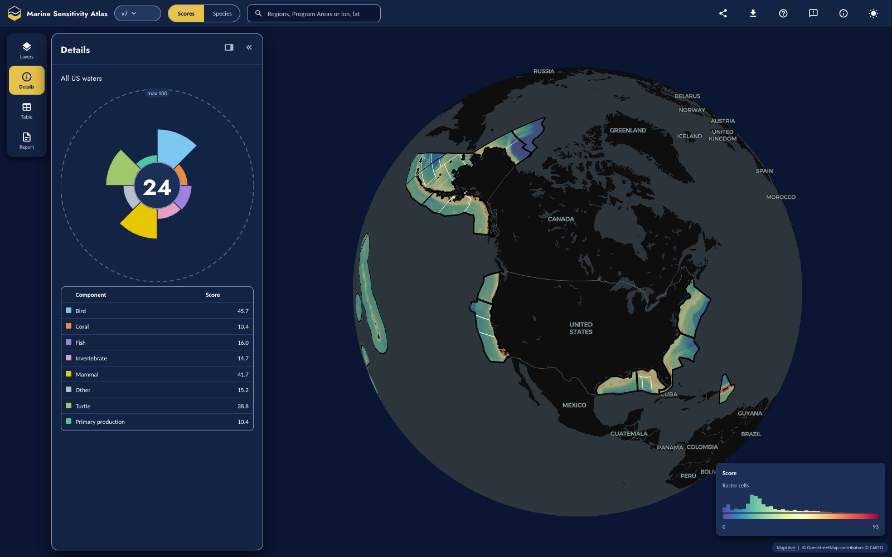
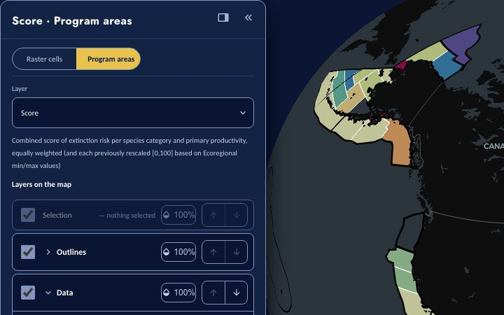
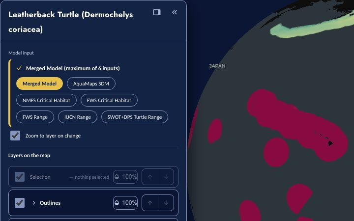
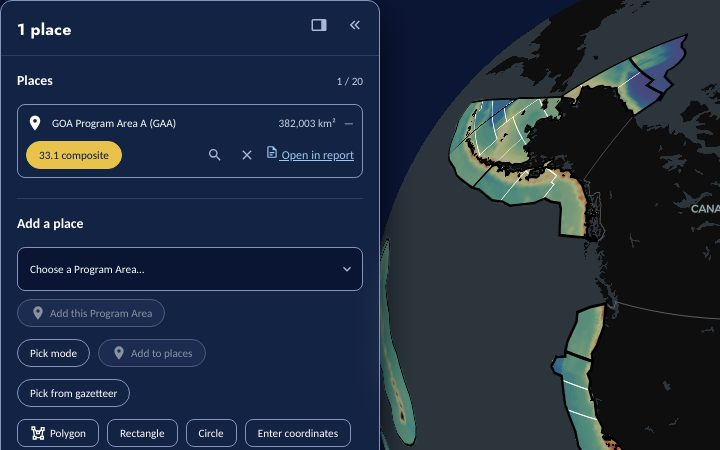
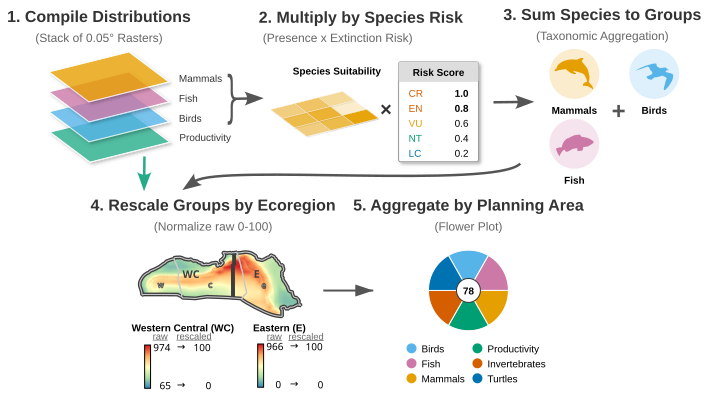

<!-- hero: the Atlas is the front door ------------------------------------ -->
```{=html}
<header class="hero">
  <div class="hero-inner">
    <div class="hero-text">
      
      <h1>Marine Sensitivity Toolkit</h1>
      <p class="tagline">An atlas of species distributions and federal conservation status, scored across US ocean waters in support of offshore energy planning.</p>
      <div class="hero-cta">
        <a class="btn-atlas" href="https://marinesensitivity.org/atlas/">Open the Atlas →</a>
        <span class="hero-release">v7 · current release</span>
      </div>
      
    </div>
    <figure class="hero-shot">
      
    </figure>
  </div>
</header>
```

<!-- three ways into the Atlas -------------------------------------------- -->
```{=html}
<section class="band band-entries" aria-labelledby="h-start">
  <div class="band-inner">
    <h2 id="h-start">Start with a question</h2>
    <div class="entries">
      <a class="entry" href="https://marinesensitivity.org/atlas/">
        
        <span class="entry-body">
          <span class="entry-title"><i class="bi bi-grid-3x3" aria-hidden="true"></i>Scores</span>
          <span class="entry-text">Composite sensitivity for every 0.05° cell or Program Area, and the species categories behind it.</span>
        </span>
      </a>
      <a class="entry" href="https://marinesensitivity.org/atlas/?lens=species">
        
        <span class="entry-body">
          <span class="entry-title"><i class="bi bi-binoculars" aria-hidden="true"></i>Species</span>
          <span class="entry-text">One species' distribution, each model input it was merged from, and its conservation status.</span>
        </span>
      </a>
      <a class="entry" href="https://marinesensitivity.org/atlas/?tool=report">
        
        <span class="entry-body">
          <span class="entry-title"><i class="bi bi-pentagon" aria-hidden="true"></i>Your area</span>
          <span class="entry-text">Draw, upload or pick an area and get its scores, its species and a printable report.</span>
        </span>
      </a>
    </div>
  </div>
</section>
```

<!-- data & code ---------------------------------------------------------- -->
```{=html}
<section class="band band-data" aria-labelledby="h-data">
  <div class="band-inner">
    <h2 id="h-data">Data and code</h2>
    <p class="lede">Every release is published openly, in formats you can query without the Atlas.</p>
    <div class="directory">
      <div class="dir-group">
        <h3>Data</h3>
        <ul>
          <li>
            <a href="https://marinesensitivity.org/stac/"><i class="bi bi-diagram-3" aria-hidden="true"></i>STAC catalog</a>
            <span>Species distribution models of v7 and later releases, described with the sdm extension. Also as <a href="https://marinesensitivity.org/stac/catalog.json">catalog.json</a> and a searchable <a href="https://stac-api.marinesensitivity.org/">STAC API</a>.</span>
          </li>
          <li>
            <a href="https://storage.marinesensitivity.org/marine-atlas/"><i class="bi bi-folder2-open" aria-hidden="true"></i>File browser</a>
            <span>The published Parquet tables and manifests of every public release, and the shared raster store they point to.</span>
          </li>
          <li>
            <a href="https://api.marinesensitivity.org"><i class="bi bi-braces" aria-hidden="true"></i>API</a>
            <span>Species lists and rendered reports for a Program Area or drawn polygon, release statistics, and OBIS summaries by H3 hexagon.</span>
          </li>
        </ul>
      </div>
      <div class="dir-group">
        <h3>Code and documentation</h3>
        <ul>
          <li>
            <a href="https://marinesensitivity.org/docs/"><i class="bi bi-book" aria-hidden="true"></i>Documentation</a>
            <span>Methods, data sources and results, one edition per release.</span>
          </li>
          <li>
            <a href="https://github.com/MarineSensitivity/msens"><i class="bi bi-box-seam" aria-hidden="true"></i>msens R package</a>
            <span>Read a release from R: scores, species lists and model cells. <a href="https://marinesensitivity.org/msens/">Reference site</a>.</span>
          </li>
          <li>
            <a href="https://marinesensitivity.org/workflows/"><i class="bi bi-journal-code" aria-hidden="true"></i>Workflows</a>
            <span>The notebooks that ingest, merge, score and publish each release.</span>
          </li>
          <li>
            <a href="https://github.com/MarineSensitivity"><i class="bi bi-github" aria-hidden="true"></i>GitHub</a>
            <span>All source code for the toolkit, the Atlas and this site.</span>
          </li>
        </ul>
      </div>
    </div>
  </div>
</section>
```

<!-- methodology ---------------------------------------------------------- -->
::::: {.band .band-method}
:::: {.band-inner}

## How the scores are made {#methodology}

::: {.method-text}
Species distribution models and range maps from AquaMaps, BirdLife, IUCN, NOAA Fisheries, USFWS and other sources are resampled onto one 0.05° grid. Each species is weighted by its extinction risk under the Endangered Species Act or the IUCN Red List, with floors for species protected by the Marine Mammal Protection Act and the Migratory Bird Treaty Act. Species categories and primary productivity are rescaled within each ecoregion and combined, equally weighted, into a composite score for every cell and Program Area. The [documentation](https://marinesensitivity.org/docs/) describes each step.
:::

::: {.method-figure}
{.lightbox}
:::

::::
:::::

<!-- about ---------------------------------------------------------------- -->
::::: {.band .band-about}
:::: {.band-inner}

## About

The Bureau of Ocean Energy Management (BOEM) is mandated under the **Outer Continental Shelf Lands Act** (OCSLA) to balance energy development with environmental protection. The Marine Sensitivity Toolkit provides spatially explicit, species-level sensitivity metrics to inform leasing decisions and environmental reviews across the National OCS Program.

```{=html}
<ul class="taxa" aria-label="Scored groups">
  <li>Fish</li>
  <li>Marine mammals</li>
  <li>Seabirds</li>
  <li>Primary productivity</li>
  <li><i class="bi bi-three-dots" aria-hidden="true"></i>And more</li>
</ul>
```

::::
:::::

<!-- releases ------------------------------------------------------------- -->
::::: {.band .band-releases}
:::: {.band-inner}

## Releases {#releases}

::: {.release-lede}
Each release is a fixed, citable build of the toolkit. The Atlas opens the current release; every earlier one stays available.
:::

::: {.release-group-title}
### Current release
:::

::: {.timeline .timeline-current}

::: {.timeline-item .current}
#### v7: species validity decoupled from Program Areas

[June 2026 – present]{.timeline-date}

Decoupled species validity from Program Area overlap. Earlier versions silently required a species to overlap a current BOEM Program Area to count as valid, which hid biodiversity outside the program cycle's footprint. Validity now means a taxonomically valid species with a modeled distribution anywhere in the study area, restoring the full set from 9,424 to **16,153 valid marine species** — of which **9,230** fall within the 20 BOEM Program Areas. Program Area membership is now applied as a spatial query rather than a species-level filter, so the map and report applications show marine life everywhere in US waters, not only within Program Areas. Scores were recomputed over the full set with negligible effect on Program Area scores (18 of 20 unchanged; only Gulf of America GAB −0.04 and GAA −0.00 shifted).

```{=html}
<div class="release-links">
  <a href="https://marinesensitivity.org/atlas/?ver=v7">Atlas (v7) →</a>
  <a href="https://marinesensitivity.org/docs/v7/">Documentation (v7) →</a>
</div>
```
:::

:::

::: {.release-group-title}
### Pre-releases under review
:::

::: {.reviewer-note}
<i class="bi bi-person-lock" aria-hidden="true"></i> Pre-releases are served from the **review host** and open only to invited reviewers: sign in with your reviewer e-mail and a one-time code is sent. The public Atlas opens on the current release and never shows a pre-release.
:::

::: {.timeline .timeline-preview}

::: {.timeline-item .preview}
#### v7.2: sea turtles and the right whale where the record places them

[October 2026 · a second patch of v7, supersedes v7.1]{.timeline-date}

A surgical patch of v7 (release id `v7c`): the same grid, species and Program Areas, v7's own scoring re-executed, and three rules, each switchable. With all three off it reproduces v7 exactly.

- **Sea turtles by the record.** A turtle species is dropped from an ecoregion where it has never been recorded in any channel: NOAA Alaska sightings, strandings and bycatch (1963–2020), fishery observers, OBIS, GBIF, iNaturalist, stranding networks. That removes four species from the East Bering Sea (no turtle in 13,317 cells with a marine mammal record) and keeps the loggerhead, green, leatherback and olive ridley in the Gulf of Alaska, where all four have been recorded. v7.1's suitability threshold, which had removed three of those, is replaced.
- **North Atlantic right whale.** Dropped from the Gulf of America, where the IUCN range had placed it at a mean of 57 across Program Areas A and B: 11 OBIS records in the Gulf against 4,133 in the Atlantic, no critical habitat, and the habitat-based density models (Roberts et al. 2016) treat it as an Atlantic species.
- **Coverage floor** kept from v7.1: a component is reported for a Program Area only where its scored cells cover at least 5% of the area. With the record rule it is what clears the last turtle slivers from the Aleutian Arc and St. George Basin.

```{=html}
<div class="release-links">
  <a href="https://preview.marinesensitivity.org/v7c/atlas/">Atlas (v7.2) →</a>
  <a href="https://preview.marinesensitivity.org/docs/v7c/">Documentation (v7.2) →</a>
</div>
```
:::

::: {.timeline-item .preview}
#### v7.1: sea-turtle core habitat and coverage floor

[September 2026 · a patch of v7]{.timeline-date}

A surgical patch of v7 (release id `v7b`): the same grid, species and Program Areas, v7's own scoring re-executed, and two method changes. With both switched off it reproduces v7 exactly.

- **Sea-turtle core habitat.** AquaMaps suitability enters the turtle merge only where it is at least 0.5 (AquaMaps' own core-habitat default), and a range cell with no suitability at or above that is dropped rather than filled at a nominal 1. Critical habitat still overrides, so no designated cell is lost. In v7 that fill, stretched by the within-ecoregion rescale, scored turtles at 46–71 in five Alaska Program Areas; in v7.1 turtles remain in one (Gulf of Alaska, 11, a small leatherback signal off Southeast Alaska) and Central California rises (19 → 27).
- **Coverage floor.** A component is reported for a Program Area only where its scored cells cover at least 5% of the area; below that it is not reportable and is left out of the composite, never published as a zero.
- **Worth a careful look:** with its below-average turtle component gone, Cook Inlet's mean of remaining components (53.2) edges past Hope Basin (52.7) for the top rank. Primary productivity is unchanged from v7; the year-integrated correction lands with v10, where a national reference makes it count.

```{=html}
<div class="release-links">
  <a href="https://preview.marinesensitivity.org/v7b/atlas/">Atlas (v7.1) →</a>
  <a href="https://preview.marinesensitivity.org/docs/v7b/">Documentation (v7.1) →</a>
</div>
```
:::

::: {.timeline-item .preview}
#### v9: AquaX and spatial extinction risk

[August 2026 · builds on v8]{.timeline-date}

Builds on the v8 Marine Atlas with two changes to *what* is scored, on the same global grid:

- **AquaX supersedes AquaMaps in US waters.** 10,536 ensemble habitat-suitability models from the AquaX framework (Reygondeau et al. 2026), delivered on the analysis grid and masked to US waters, replace AquaMaps for the same species wherever AquaX was modeled (10,517 species); AquaMaps continues for the ~6,000 species AquaX did not model and everywhere outside its mask. Each input can be viewed *as delivered* and *as ingested*.
- **Extinction risk is spatial for species listed by Distinct Population Segment.** For the 19 species whose ESA listing applies to some populations only (humpback and Southern Resident killer whales, Cook Inlet beluga, the salmon and steelhead ESUs, both sturgeons, …) risk is a per-cell surface — each listed entity's status inside its designated critical habitat, from NOAA Fisheries' authoritative service, and the species' baseline elsewhere — carried beside the merged model and applied at scoring. The humpback no longer reads Endangered species-wide from DPSs that breed outside US waters.
- **Program-Area scores stay equivalent** to v8 on common inputs (a control run with supersession off reproduces v8 exactly), and the 2,742 species AquaX modeled but found absent in US waters keep their AquaMaps surface pending review.

```{=html}
<div class="release-links">
  <a href="https://preview.marinesensitivity.org/v9/atlas/">Atlas (v9) →</a>
  <a href="https://preview.marinesensitivity.org/docs/v9/">Documentation (v9) →</a>
</div>
```
:::

::: {.timeline-item .preview}
#### v8: Marine Atlas

[July–August 2026 · a ground-up rebuild]{.timeline-date}

A ground-up rebuild as a global **Marine Atlas**. What differs from v7:

- **Whole-range global ingest.** Every species is modeled across its *entire* global range on a shared global 0.05° ocean grid — no US land mask, no Program-Area gate — so a species' full distribution is captured and "how marine" is a *derived* metric, not a filter.
- **Seabird de-duplication.** A BirdLife-sisid ↔ WoRMS-aphia crosswalk merges each bird's BirdLife, USFWS, and AquaMaps inputs into a *single* model; v7 split some seabirds across two taxa (e.g. Marbled Murrelet, Brown Pelican). This removes double-counting — seabird-heavy Program Areas (Alaska, Pacific) score several points lower than v7 as a result, with overall Program-Area correlation to v7 of 0.94.
- **Original *and* interpolated distributions.** Each source model is published in two representations — the native-resolution original (e.g. AquaMaps 0.5° HCAF) and the 0.05° interpolated surface used in scoring — stored in a **STAC** catalog and toggleable in the Atlas.
- **Partitioned-Parquet marine-atlas on S3.** All layers are released as content-addressed, partitioned Parquet served via titiler + a STAC catalog, replacing per-dataset archives.
- **Taxonomy-driven categories.** Species categories come from WoRMS taxonomy (no catch-all "other" bucket); reptiles and amphibians are excluded from scoring.

```{=html}
<div class="release-links">
  <a href="https://preview.marinesensitivity.org/v8/atlas/">Atlas (v8) →</a>
  <a href="https://preview.marinesensitivity.org/docs/v8/">Documentation (v8) →</a>
</div>
```
:::

:::

::: {.release-group-title}
### Earlier releases
:::

::: {.timeline .timeline-history}

::: {.timeline-item}
#### v6

[March 2026 – June 2026]{.timeline-date}

Excluded 371 species (343 fish, 20 invertebrates, 6 corals, 2 mammals) whose IUCN expert range maps fall entirely outside the US EEZ — their AquaMaps predictions in US waters were edge-of-range model artifacts with near-zero suitability, now removed. Ingested 3 missing mammal IUCN range maps (*Phoca vitulina*, *Trichechus manatus*, *Pusa hispida*) from more complete IUCN mammals download. Net effect on Program Area scores is negligible: Southern California (SOC) Score +1, coral +3, fish -1.

```{=html}
<div class="release-links">
  <a href="https://marinesensitivity.org/atlas/?ver=v6">Atlas (v6) →</a>
  <a href="https://marinesensitivity.org/docs/v6/">Documentation (v6) →</a>
</div>
```
:::

::: {.timeline-item}
#### v5

[March 2026]{.timeline-date}

Fixed MMPA spatial floor (minimum 20) for FWS-managed marine mammals (walrus, polar bear, sea otter, manatee, dugong) that were missing MMPA protection in earlier versions. Documented the bifurcation of modeling approaches: standard species use a scalar extinction risk weight at scoring time, while sea turtles use a spatially varying extinction risk raster (from SWOT+DPS) multiplied during model merging.

```{=html}
<div class="release-links">
  <a href="https://marinesensitivity.org/atlas/?ver=v5">Atlas (v5) →</a>
  <a href="https://marinesensitivity.org/docs/v5/">Documentation (v5) →</a>
</div>
```
:::

::: {.timeline-item}
#### v4b

[March 2026]{.timeline-date}

Multiplicative sea-turtle merge: the Distinct Population Segment extinction-risk surface is multiplied into the suitability surface while merging, with critical habitat overriding by maximum, so a turtle's risk varies across its range. Those species pass through scoring at full weight so their risk is not counted twice.

```{=html}
<div class="release-links">
  <a href="https://marinesensitivity.org/atlas/?ver=v4b">Atlas (v4b) →</a>
  <a href="https://marinesensitivity.org/docs/v4b/">Documentation (v4b) →</a>
</div>
```
:::

::: {.timeline-item}
#### v4

[March 2026]{.timeline-date}

Replaced overly extensive IUCN sea turtle range maps with more realistic State of the World's Turtles (SWOT) global distributions (viewable at [seamap.env.duke.edu/swot](http://seamap.env.duke.edu/swot)). Applied NOAA Distinct Population Segment (DPS) polygons with ESA listing status (NMFS:EN 100, NMFS:TN 50) to differentiate Endangered vs Threatened populations, resulting in more restrictive distributions dominated by ESA risk values. (See workflow [ingest\_turtles-swot-dps](https://marinesensitivity.org/workflows/ingest_turtles-swot-dps.html).)

```{=html}
<div class="release-links">
  <a href="https://marinesensitivity.org/atlas/?ver=v4">Atlas (v4) →</a>
  <a href="https://marinesensitivity.org/docs/v4/">Documentation (v4) →</a>
</div>
```
:::

::: {.timeline-item}
#### v3

[February 2026]{.timeline-date}

Program Areas for the National OCS Plan. Ecoregion rescaling. Seven source datasets merged from continuous suitability models (AquaMaps) to binary range maps (NMFS, FWS, BirdLife, IUCN) with masking (where global IUCN range map exists). New species sensitivity weighting based on national ESA or global IUCN extinction risk along with protection from Marine Mammal Protection Act (MMPA) and Migratory Bird Treaty Act (MBTA).

```{=html}
<div class="release-links">
  <a href="https://marinesensitivity.org/atlas/?ver=v3">Atlas (v3) →</a>
  <a href="https://marinesensitivity.org/docs/v3/">Documentation (v3) →</a>
</div>
```
:::

::: {.timeline-item}
#### v2

[January 2026]{.timeline-date}

Transition to Program Areas (2026). Individual model layers. Model merging pipeline. Cloud-optimized GeoTIFF storage.

```{=html}
<div class="release-links">
  <a href="https://marinesensitivity.org/atlas/?ver=v2">Atlas (v2) →</a>
  <a href="https://marinesensitivity.org/docs/v2/">Documentation (v2) →</a>
</div>
```
:::

::: {.timeline-item}
#### v1

[September 2023 – December 2025]{.timeline-date}

Planning Areas across U.S. EEZ. AquaMaps-based species distributions. Flower plots for multi-taxa visualization. Species tables with conservation status.

```{=html}
<div class="release-links">
  <a href="https://marinesensitivity.org/atlas/?ver=v1">Atlas (v1) →</a>
  <a href="https://marinesensitivity.org/docs/v1/">Documentation (v1) →</a>
</div>
```
:::

:::

::::
:::::
